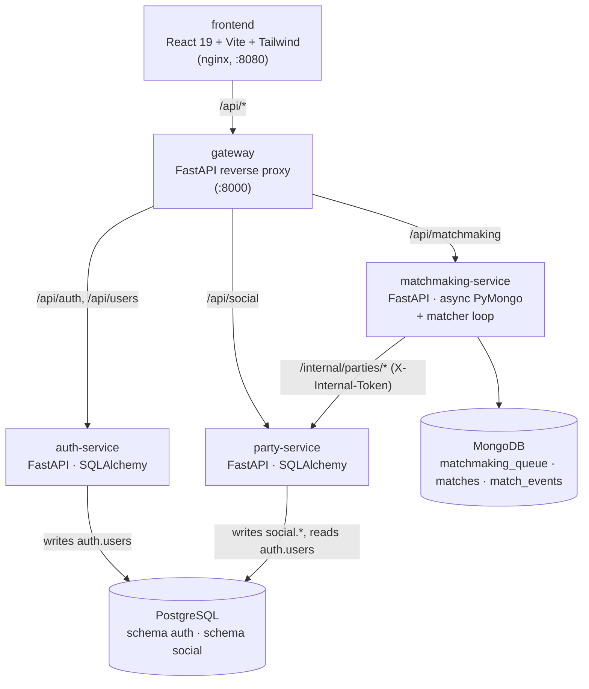
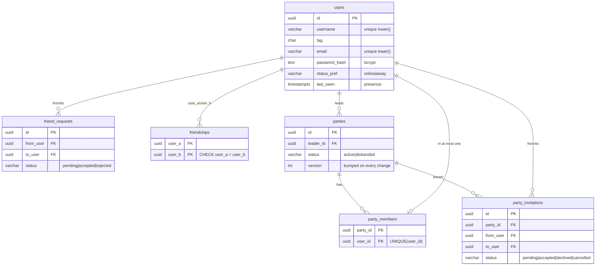

# WARCIS

A distributed multiplayer gaming hub: accounts, friends, parties of 1–4 players, and
squad matchmaking. It is a vertical slice for a Design of Distributed Database
Management Systems course project: a React launcher in front of three FastAPI services
that use two different databases, **PostgreSQL** for relational social state and
**MongoDB** for matchmaking and match documents.

```
SIGN IN → HOME → FRIENDS → PARTY (1–4) → MATCHMAKING → MATCH FOUND → MATCH LOBBY (class + weapon, ready) → PLAY → SCOREBOARD → PLAY AGAIN / PROFILE
```

Entering a match drops every player into a small **Capture The Flag** game (1v1, 2v2 or 4v4)
served by an authoritative WebSocket game-service. See [Gameplay](#gameplay-capture-the-flag).

---

## Architecture



| Component | Responsibility | Data |
|---|---|---|
| **frontend** | The launcher UI. Polls the gateway every 1.5 s and sends a heartbeat every 10 s. | JWT in `sessionStorage` |
| **gateway** | Single public origin. Routes by path prefix, forwards `Authorization`, and returns backend responses unchanged. Never exposes `/internal`. | – |
| **auth-service** | Register, login (bcrypt), JWT issue, profile, presence (online/away/offline). | `auth.users` |
| **party-service** | Friends, friend requests, parties, invitations, and every party rule. Answers matchmaking's validation calls. | `social.*` |
| **matchmaking-service** | Queue, cancel, status, team formation, match lifecycle (lobby: loadout + ready → countdown → in progress → leave). | MongoDB |

Every service verifies the JWT itself with the shared `JWT_SECRET`, so no request needs a
round trip to auth-service. Service-to-service calls go to `/internal/*`, which checks a
shared `X-Internal-Token`. The gateway never routes those paths.

### Project layout

```
.
├── frontend/                 Vite app (+ Dockerfile, nginx.conf)
├── gateway/                  FastAPI reverse proxy
├── services/
│   ├── common/warcis_common JWT verification + structured errors (shared)
│   ├── auth-service/app/     main.py, api/, models/, schemas/, services/, db/
│   ├── party-service/app/    same layout
│   └── matchmaking-service/app/
├── db/postgres/01_schema.sql Postgres DDL (applied on first boot)
├── scripts/                  e2e.py (rule checks), bots.py (demo players), api.py
└── docker-compose.yml
```

---

## Run it

Requires Docker Desktop.

```bash
cp .env.example .env          # then replace every change-me value
docker compose up --build     # first boot applies db/postgres/01_schema.sql
```

Open **http://localhost:8080**. The gateway is also reachable at http://localhost:8000.
PostgreSQL and MongoDB are exposed on `127.0.0.1` only (ports are set in `.env`) so you can
inspect them.

Optional: bot players are real accounts that use the public API, so a 4v4 can form
with only one or two humans:

```bash
docker compose --profile demo up -d bots     # parties of 2,1,3,1 by default (BOT_PARTIES)
```

Frontend dev server with hot reload (the backend still runs in Docker):

```bash
cd frontend && npm install && npm run dev    # proxies /api to localhost:8000
```

Reset all data: `docker compose down -v`.

---

## Demo script (multiple browser tabs)

The session lives in `sessionStorage`, so **each tab is a separate signed-in user** and a
refresh keeps you signed in.

1. `docker compose --profile demo up -d --build`. This starts the stack plus 7 queued bots.
2. **Tab A**: *Create Account* as `Astra`.
3. **Tab B**: *Create Account* as `Brick`. On **Friends**, add `Astra`. The request shows as *Outgoing · pending*.
4. **Tab A**: the Friends badge shows 1. Accept. Both tabs now list each other.
5. **Tab A**: **Party**, then *Invite friend*, then Brick. The slot shows *Invite sent…* and MATCHMAKE is blocked.
6. **Tab B**: the invite toast appears. Click **Join**. Both tabs show **PARTY 2 / 4**. Brick sees
   *"Waiting for Astra to start the queue"* (the server also returns `403 NOT_LEADER`).
7. **Tab A**: **MATCHMAKE**. The queue entry goes into MongoDB. Your party of 2 plus the bots fill two
   teams and **MATCH FOUND** appears in both tabs with real teams and party grouping.
8. In the **match lobby**, pick a class and a weapon, then press READY (that locks your choice). The server starts the countdown once everyone is ready. Play until a flag is captured. Press **Q** for your class ability.
9. The end screen shows the scoreboard. The party leader clicks **PLAY AGAIN** to requeue the same party,
   or anyone clicks **RETURN TO HUB**. Open **Profile** for career stats and match history; friends show
   their record (`3W–1L · 1.25 K/D`) in the friends list.
10. Refresh either tab. You are still signed in and still in the same match or party.

Inspect the data while you go:

```bash
docker compose exec postgres sh -c 'psql -U $POSTGRES_USER -d $POSTGRES_DB'
#   select * from social.party_members;  select * from social.parties;
docker compose exec mongodb sh -c 'mongosh -u $MONGO_INITDB_ROOT_USERNAME -p $MONGO_INITDB_ROOT_PASSWORD --authenticationDatabase admin warcis'
#   db.matchmaking_queue.find({status:"WAITING"});  db.matches.find().sort({created_at:-1}).limit(1)
```

Automated rule check (stop the bots first so the queue is empty):

```bash
docker compose stop bots
pip install httpx && python scripts/e2e.py         # → ALL E2E CHECKS PASSED
cd services/matchmaking-service && python -m app.services.packing   # → packing ok
cd services/common && python -m warcis_common.loadout                  # → loadout ok
# lobby timeout case: start the stack with READY_TIMEOUT_S=15, then  E2E_READY_TIMEOUT_S=15 python scripts/e2e.py
cd services/matchmaking-service && python -m app.services.stats     # → stats ok
```

---

## Gameplay: Capture The Flag

`services/game-service` runs the match. Rules live in `app/sim.py` (pure, self-checking:
`cd services/game-service && python -m app.sim`), the WebSocket loop in `app/main.py`.

- **Roster** comes from the match document: `teams[0]` is RED, `teams[1]` is BLUE. No new team logic.
- **Connect:** `WS /api/game/ws/{match_id}?token=<JWT>` (nginx → gateway → game-service). The room
  starts on the first connection; everyone spawns at their team's spawn points.
- **Client → server (intents only):** `{"t":"input", up, down, left, right}`, `{"t":"fire", x, y}` (aim point) and
  `{"t":"ability", x, y}` (Q, aimed the same way). Class and weapon are never sent by a client.
- **Server → clients at 30 Hz:** `{"t":"state", players, flags, shots, barriers, state, winner, elapsed}`. Each team gets
  its own snapshot (see *Invisibility* below). `hello` carries a `catalog` of class and weapon numbers for the HUD.
- Server decides movement, wall collision, projectiles (swept along their whole path each tick, so fast rounds
  never tunnel a wall or a barrier), damage, death, 3 s respawn, flag pickup / drop on death / return by own
  team / auto-return after 10 s, and capture.
- **Winning:** a capture scores a round (4 s frozen reset between rounds); first to 3 wins, or the higher score
  at 10:00. Level at 10:00 is **sudden death**: respawns stop (whoever is down stays down) and the next capture
  wins. Still level at 12:00, the match is finalized: the team that carried the enemy flag furthest toward home
  this round wins (*objective progress*; a pickup counts as 1 %), then the team with more kills, else it is a
  **draw**. The result records how it was decided (`decided_by`); a draw (stored as winner `TIE`) is left out
  of career wins, losses, matches and win rate.

### Match lobby, classes and weapons

`FOUND` is the **match lobby**. "Match found" is only a short client-side reveal; the server has no extra accept step.
Each player picks a class and a weapon independently (`PUT …/loadout`, changeable until READY), the server stores them
on the match document, and READY is refused without one. READY locks the choice. The match starts once everyone is
ready; if the lobby is not complete by `lobby_ends_at` the whole match is cancelled (no defaults, no re-queue).
During the lobby you see your own team's picks and the enemy team's ready flags, never the enemy's picks; both teams'
loadouts are visible once the match starts. Duplicate classes and weapons on a team are allowed.

| Class | HP | Q ability |
|---|---|---|
| Assaulter | 85 | **Dash** ≈160 px in 160 ms (5 s cooldown); fires 25 % faster; still damageable while dashing |
| Guardian | 140 | **Barrier** 90×12 px, 150 HP, lasts 8 s (14 s cooldown); blocks *enemy projectiles only*, never movement, and outlives its owner |
| Assassin | 100 | **Invisibility** 5 s (15 s cooldown); ends on any damage, on firing, or on picking up the enemy flag; cannot be started while carrying a flag |

| Weapon | Damage | Cooldown | Notes |
|---|---|---|---|
| Assault Rifle | 14 | 160 ms | balanced, ≈770 px range |
| Shotgun | 9 × 7 pellets | 850 ms | fixed fan, ≈270 px range |
| Sniper Rifle | 70 | 1500 ms | 1600 px/s, ≈1440 px range; never a one-shot |

All numbers live in one table at the top of `app/sim.py`. They are initial values and need playtesting.

**Invisibility is enforced on the server.** An invisible Assassin is sent to its enemies *without coordinates*
(`x`/`y` are `null`, `hidden: true`, and its ability timer is withheld), in every frame including the first one after a
reconnect; allies and the Assassin see it as a faint shimmer. Hidden players can still be shot.
- **Capture** only counts while your own flag is `AT_BASE`. The first capture ends the match: the server
  writes the result onto the match (see [Results, history and stats](#results-history-and-stats)) and logs
  `MATCH_ENDED`. "Return to hub" uses the existing `/matchmaking/matches/{id}/leave`, which completes the match.
- **Stats:** the sim counts each player's `kills` (a hit that drops an enemy to 0 HP), `deaths` and flag
  `captures`. They ride along in every snapshot and in the 3 s checkpoints, so a restart keeps them.
- **End screen:** a scoreboard (your team, opponents; captures, kills, deaths) and **PLAY AGAIN** (party leader)
  or **RETURN TO HUB**. A party member who is not the leader sees who can queue again.

- **Client** (`frontend/src/Game.tsx`, `src/game/`) renders ~100 ms behind the server and interpolates
  between snapshots (no prediction: the server stays the only authority). Events such as flag stolen,
  dropped, returned or captured, and eliminations, come from diffing snapshots. Sounds are synthesized
  with WebAudio.
- **Bots** (`scripts/bots.py` + `scripts/bot_ai.py`) enter the match and play over the same WebSocket
  protocol, at ~10 Hz. They chase an enemy carrier, recover a dropped flag, attack or defend (one bot per
  team guards the base), fight what they can see (reaction delay + aim noise; pace and range follow their weapon), use Q (dash to escape with the flag, barrier against an incoming enemy, cloak on the way to the flag, to ambush a carrier or an attacker, or to escape when hurt), otherwise patrol. In the lobby they pick a random class and weapon. They use
  grid BFS around walls and get no extra stats. A player with no live socket keeps their state and is shown "OFFLINE".
- **Recovery:** every 3 s (and on clean shutdown) a small checkpoint goes to MongoDB `game_checkpoints`
  (players with class, weapon and cooldowns, flags, barriers, timers, winner). On startup the service restores PLAYING checkpoints newer than 10 min
  of `IN_PROGRESS` matches; clients and bots reconnect on their own. Anything else is logged and marked
  `ABANDONED`, never invented.

Full-stack checks (`pip install httpx websockets`):

```bash
python scripts/ctf_e2e.py 1 2 4          # bots stopped: real 1v1/2v2/4v4, one socket per player; also checks the stored
                                         # result, history, career stats and play-again requeue
python scripts/ctf_e2e.py recovery       # restart game-service mid-match, state is restored
CTF_CRASH=1 python scripts/ctf_e2e.py recovery   # same with SIGKILL (periodic checkpoint only)
python scripts/ctf_e2e.py abilities      # classes over real sockets: invisibility privacy (incl. first frame after reconnect),
                                         # barrier, dash. Also: lobby bypass is refused (WS opened before the match starts)
python scripts/ctf_e2e.py bots           # bots running: 1 human + 7 bots, restart mid-match
python scripts/bot_ai.py                 # bots-only games against the real sim
```

1v1 and 2v2 need the queue's fill-off option.

## API overview

All routes are behind the gateway at `/api`. Errors always have the shape
`{"error": {"code": "PARTY_FULL", "message": "Party is full."}}`.

| Method | Path | Notes |
|---|---|---|
| POST | `/auth/register` | `{username, email, password}` → `{token, user}` (201) |
| POST | `/auth/login` | `{login, password}`. `login` is a username or email. |
| POST | `/auth/logout` | Marks you offline. |
| GET | `/users/me` · `/users/{id}` | Profile with computed presence. |
| POST | `/users/me/heartbeat` | Keeps presence online. |
| PATCH | `/users/me` | `{status: online\|away}` |
| GET | `/social/state` | Friends, requests, party and invitations in one call (what the UI polls). |
| GET | `/social/users/search?q=` | Username prefix search. |
| GET / POST | `/social/friend-requests` | POST `{username}`; `Name#1234` is accepted. If they already asked you, this accepts. |
| POST | `/social/friend-requests/{id}/accept` · `/reject` | |
| GET | `/social/friends` | |
| GET / POST | `/social/party` | POST is idempotent: it creates a party or returns your existing one. |
| POST | `/social/party/invitations` | `{user_id}`. Creates your party if needed. |
| DELETE | `/social/party/invitations/{id}` | Cancel (sender or leader only). |
| POST | `/social/party/leave` | Leader leaves → the longest-standing member is promoted. Empty → disbanded. |
| DELETE | `/social/party/members/{user_id}` | Kick (leader only). |
| GET | `/social/invitations` | Invitations sent to you. |
| POST | `/social/invitations/{id}/accept` · `/decline` | Accepting leaves your old party in the same transaction. |
| POST / DELETE | `/matchmaking/queue` | POST `{mode: squad, fill: bool}` (leader only, idempotent). DELETE (any member, idempotent). Queueing again from a finished match is the rematch: it also moves the whole party out of that match. |
| GET | `/matchmaking/status` | `idle` · `searching` (with live team formation) · `found` (the match lobby) · `countdown` · `entered`. A match carries `loadouts` (your team's picks while the lobby is open, everyone's once the match runs) and `lobby_ends_at`. |
| PUT | `/matchmaking/matches/{id}/loadout` | `{class: ASSAULTER\|GUARDIAN\|ASSASSIN, weapon: ASSAULT_RIFLE\|SHOTGUN\|SNIPER_RIFLE}`. Change it freely until you ready up. `409 LOADOUT_LOCKED` once you are ready or the lobby is closed. |
| POST | `/matchmaking/matches/{id}/ready` | Needs a stored loadout (`409 LOADOUT_REQUIRED`) and locks it. The last ready starts the 3 s countdown. |
| POST | `/matchmaking/matches/{id}/leave` | Back to hub. Leaving (declining) before the match starts cancels it for everyone. |
| GET | `/matchmaking/stats?ids=a,b,…` | Career `matches, wins, losses, kills, deaths, captures, kd, win_rate` per user id (max 50). Any signed-in user can read any player's stats. |
| GET | `/matchmaking/history?limit=&before=` | Your finished matches, newest first, each with the full scoreboard. Page with `next_before`. |

Status codes: `400` invalid request · `401` bad or missing JWT · `403` not allowed (not leader,
not friends) · `404` not found · `409` conflicting state (full, already queued, pending
invites, in a match) · `502/503` a service is unreachable.

---

## PostgreSQL schema

`db/postgres/01_schema.sql` holds the full DDL.



The constraints do the real work:

- `UNIQUE (party_members.user_id)`: a user is in **at most one party**.
- A `BEFORE INSERT` trigger on `party_members` rejects a 5th member, backing up the service's check.
- Partial unique indexes: one *pending* friend request per direction, and one *pending* invite
  per (party, user).
- `friendships` stores each undirected pair once (`CHECK user_a < user_b`).
- `CHECK` constraints on the username format, tag format and every status enum.

Party tables reference `auth.users` by foreign key and store **no copies** of user data.

## MongoDB collections

```js
// matchmaking_queue: one document per queued party
{ queue_id, party_id, party_version, leader_id, mode: "SQUAD", fill: bool,
  players: [{id, name, tag}], player_ids: [...], size: 1..4,
  joined_at, status: "WAITING"|"MATCHED"|"CANCELLED"|"INVALIDATED", match_id? }
// unique partial index {party_id} where status = "WAITING"  → a party cannot queue twice

// matches
{ match_id, mode, status: "FOUND"|"COUNTDOWN"|"IN_PROGRESS"|"COMPLETED"|"CANCELLED",
  teams: [ { players: [{id,name,tag}], parties: [{party_id, players: [ids]}] }, {...} ],
  player_ids, ready: [ids], entered: [ids], left: [ids], created_at, ended_at?,
  loadouts: { <user_id>: { class, weapon, at } },   // filled in the lobby; locked once the player is ready
  lobby_ends_at,                                    // created_at + READY_TIMEOUT_S (60 s)
  reason? }                                         // CANCELLED: "player_left" | "lobby_timeout"

// once the game is over, game-service adds (exactly once) to the same document:
//   result: { winner: "RED"|"BLUE", capturer: user_id, duration_ms, at,
//             players: [{ id, name, team, class, weapon, outcome: "WIN"|"LOSS", kills, deaths, captures }] }  // class/weapon absent on old results

// match_events: append-only log, ready for future gameplay events
{ match_id, type: "MATCH_CREATED"|"PLAYER_READY"|"PLAYER_ENTERED"|"PLAYER_LEFT"|"MATCH_COMPLETED"|"MATCH_CANCELLED"
         |"MATCH_ENDED"|"PLAYER_RESULT",
  user_id?, at, data }
// MATCH_ENDED: {winner, duration_ms}; PLAYER_RESULT (one per player): {team, outcome, kills, deaths, captures}
```

### Results, history and stats

When the game ends, game-service writes `result` onto the match document (guarded by `result: {$exists: false}`
so it is set once) and appends `MATCH_ENDED` plus one `PLAYER_RESULT` event per player. Everything the player
sees afterwards is derived from that one document:

- **Scoreboard** at the end of a match comes from the live snapshot. If you reconnect after the room has been
  unloaded, the stored `result` (also returned in the match view) fills it in.
- **History** (`/matchmaking/history`) is a keyset-paged query over `matches` where `result` exists.
- **Profile and friends-list stats** (`/matchmaking/stats`) are a MongoDB aggregation over the same documents
  (`$unwind result.players`, `$group` by player). Nothing is stored twice, so a stat cannot drift from the
  matches it was computed from. Cancelled and abandoned matches have no `result` and do not count.

This is a deliberate use of the two stores: the per-match scoreboard is a nested document that is always read
whole, which MongoDB stores as one document with no joins. User identity (names, friends) stays in PostgreSQL
and is only joined in the UI by id.

**Play again.** The end screen's button calls the ordinary `POST /matchmaking/queue` as the party leader.
`enqueue` first marks the whole party as having left their finished match (the same state "Return to hub"
sets), then queues the party as it is now. Teammates still looking at the scoreboard are moved to the new
search by their next status poll. A match that is still being played keeps blocking `enqueue` (`IN_MATCH`).

### Matching algorithm (`matchmaking-service/app/services/packing.py`)

This is deterministic and has no MMR. Parties are never split. With `fill: true` (default),
the oldest waiting party anchors a team, which is completed by the combination of later
parties that adds up to exactly 4 players, preferring the **fewest** parties and then the
earliest. A full premade of 4 is a team on its own. Two full teams, in queue order, make a
match. With `fill: false`, a party is queued and matched exactly as-is: never combined with
another party, FIFO-paired against whichever other `fill: false` party is next regardless of
size (e.g. 3v2). The two pools never mix. The same functions drive the *"Your team"* preview
on the searching screen, so the preview always matches the team you will actually get.

---

## Distributed database design

### Why PostgreSQL for users, friends and parties

This data is relational and full of invariants: "at most one party per user", "at most 4
members", "only friends can be invited", "a friendship is mutual". Those are foreign keys,
unique constraints, `CHECK`s and a trigger, enforced by the database no matter which code
path writes. Joining a party means changing several rows at once (the invite, the old
party, the new party, membership), so it needs **ACID transactions** and **row locks**.

### Why MongoDB for matchmaking and matches

Queue entries and matches are short-lived, written often, and document-shaped: a match
is a nested structure of teams → parties → players that is always read whole. Storing it
as one document means reading a match is a single lookup with no joins. The schema can
also grow (per-player stats, events, server assignment) without migrations, and
`match_events` is a natural append-only log for the future game service. Denormalizing
player names into queue and match documents is deliberate: those documents are snapshots
of who was matched, not the source of truth for users.

### Consistency boundaries

There is **no distributed transaction** between PostgreSQL and MongoDB, and the system
does not pretend otherwise.

- **PostgreSQL is authoritative** for users, friendships and party membership.
- **MongoDB is authoritative** only for queue and match state, which is *derived* from a
  party snapshot.

The gap between the two is closed with **optimistic validation**:

1. On enqueue, matchmaking asks party-service (HTTP, `/internal/parties/for-queue/{user}`)
   for a fresh snapshot: members, leader, `version`, pending invites. It checks
   *leader-only* and *no pending invites*, then stores `party_version` in the queue document.
2. Every membership or leader change in Postgres bumps `parties.version` inside the same
   transaction.
3. Every matcher tick (about 1 s) sends one batch call, `/internal/parties/validate`, with
   all waiting `(party_id, version)` pairs. Parties whose version changed, that were
   disbanded, or that have a member whose heartbeat went stale are marked `INVALIDATED` and
   left out of matching. **No match is ever formed from unverified state.** If party-service
   is down, the tick fails and forms nothing.
4. Queue entries are claimed with a conditional `update_many({status: "WAITING"})`, and the
   claim counts only if `modified_count` equals the number of entries. A concurrent cancel
   makes the claim fail, and the partially claimed entries are released. If inserting the
   match document fails, the claimed entries are put back to `WAITING` (a compensating
   action). This avoids needing a MongoDB replica set for multi-document transactions.
5. A match lobby that isn't completed within `READY_TIMEOUT_S` (default 60 s: everybody picked a loadout and readied) cancels the whole match, so an
   abandoned client can't block the other players forever. Nobody is given a default loadout and nobody is re-queued.

The result is eventual consistency between the stores with a window of at most one
matcher tick. A party that changes while queued is dropped from the queue before it could
be matched.

### Consistency inside PostgreSQL

Accepting an invite, leaving, kicking and inviting each run in **one transaction** that
locks the party row(s) with `SELECT … FOR UPDATE`. When a user switches parties, both rows
are locked **in id order** so two users swapping parties can't deadlock. The trigger and
unique constraints are the backstop if application code ever forgets a check.

### Known limits (deliberate for this phase)

- The launcher uses HTTP polling (1.5 s); only in-match gameplay uses a WebSocket.
- Game rooms live in game-service memory (one replica). A restart resumes from the last checkpoint
  (at most ~3 s old after a crash); shots in flight and held keys are not persisted.
- One matchmaking replica: the matcher loop runs in-process. Claims are already
  conditional, but running several replicas would also need a leader lock.
- Class and weapon balance values are first guesses (see the tables above) and need playtesting.
- The game socket has no per-connection message rate limit: a client flooding `fire`/`ability` costs the server CPU only (the cooldowns still apply).
- Ship the frontend and backend together: an old cached bundle cannot pick a loadout, so it cannot ready up and its lobby times out.
- No MMR, region or latency in matchmaking. The region label in the UI is cosmetic.
- The activity feed on the home screen is per client and not persisted.
- Stats count finished matches only and are recomputed on every request (an indexed aggregation). If the
  match collection grows large, keep running totals per player in a `player_stats` collection, updated when
  the result is written.
