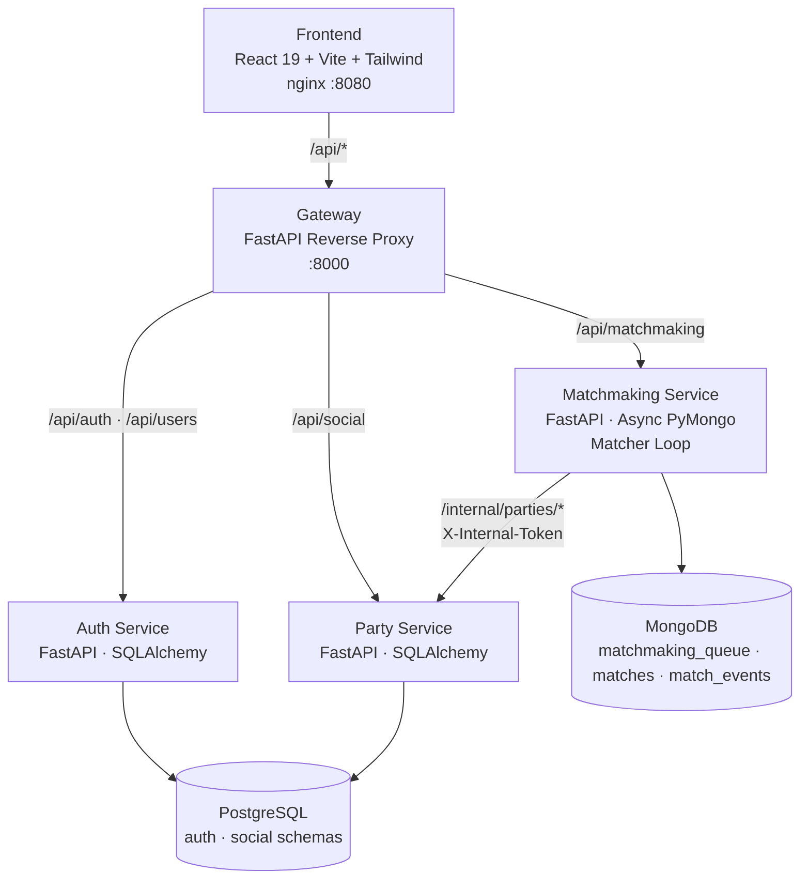
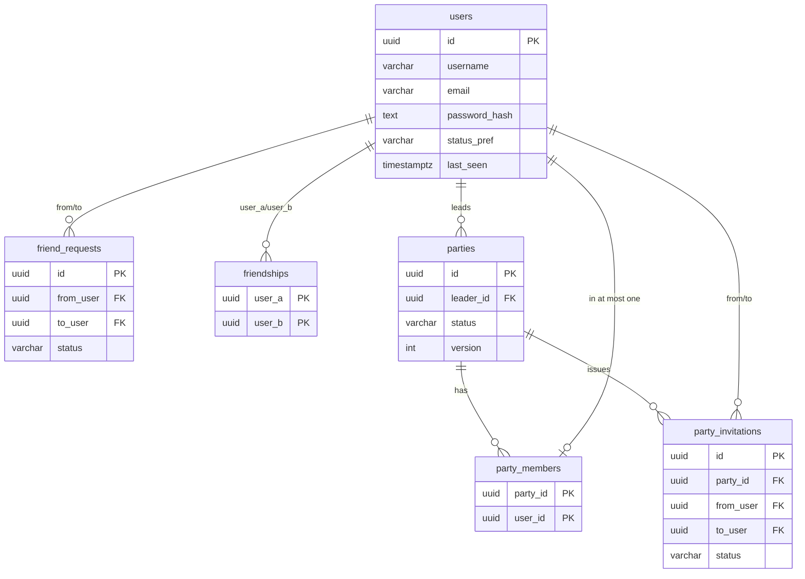

# WARCIS

**WARCIS** is a distributed multiplayer gaming hub featuring user accounts, friends, parties, matchmaking, and multiplayer gameplay.

Built as a vertical slice for the **Design of Distributed Database Management Systems** course, the project demonstrates a microservice-based architecture backed by two different databases:

- **PostgreSQL** — relational and transactional social data
- **MongoDB** — matchmaking queues, matches, and gameplay results

The application includes a React-based launcher, three FastAPI backend services, a reverse-proxy gateway, and an authoritative WebSocket game server.

## User Flow

```text
SIGN IN
   ↓
HOME
   ↓
FRIENDS
   ↓
PARTY (1–4 PLAYERS)
   ↓
MATCHMAKING
   ↓
MATCH FOUND
   ↓
MATCH LOBBY (CLASS + WEAPON + READY)
   ↓
PLAY
   ↓
SCOREBOARD
   ↓
PLAY AGAIN / PROFILE
```

Players enter a Capture The Flag (CTF) match with support for **1v1, 2v2, and 4v4** gameplay.

---

# Architecture

## System Architecture



## Services

| Component | Responsibility | Data |
|---|---|---|
| **Frontend** | Launcher UI, user interaction, matchmaking and match lobby. Polls every 1.5 seconds and sends heartbeats every 10 seconds. | JWT in `sessionStorage` |
| **Gateway** | Single public entry point. Routes requests by path, forwards authorization headers, and returns backend responses. | — |
| **Auth Service** | Registration, login, password hashing, JWT generation, profiles and presence. | `auth.users` |
| **Party Service** | Friends, friend requests, parties, invitations, membership rules and matchmaking validation. | `social.*` |
| **Matchmaking Service** | Queue management, team formation, cancellation, match lifecycle, lobby readiness and results. | MongoDB |
| **Game Service** | Authoritative real-time CTF simulation over WebSockets. | In-memory game state + MongoDB checkpoints |

### Service Communication

- Every backend service independently validates JWTs using the shared `JWT_SECRET`.
- No request requires a round trip to the Auth Service solely for token validation.
- Internal service communication uses `/internal/*` endpoints protected by a shared `X-Internal-Token`.
- The Gateway never exposes or routes internal endpoints.

---

## Project Structure

```text
.
├── frontend/                  React + Vite application
│   ├── Dockerfile
│   └── nginx.conf
│
├── gateway/                   FastAPI reverse proxy
│
├── services/
│   ├── common/
│   │   └── warcis_common/     Shared JWT verification and errors
│   │
│   ├── auth-service/
│   │   └── app/
│   │       ├── main.py
│   │       ├── api/
│   │       ├── models/
│   │       ├── schemas/
│   │       ├── services/
│   │       └── db/
│   │
│   ├── party-service/
│   │   └── app/               Similar service structure
│   │
│   ├── matchmaking-service/
│   │   └── app/
│   │
│   └── game-service/
│       └── app/
│
├── db/
│   └── postgres/
│       └── 01_schema.sql       PostgreSQL DDL
│
├── scripts/
│   ├── e2e.py                 Rule and API checks
│   ├── bots.py                Demo players
│   ├── bot_ai.py              Game bot AI
│   ├── api.py
│   └── ctf_e2e.py             Gameplay integration tests
│
└── docker-compose.yml
```

---

# Getting Started

## Prerequisites

- Docker Desktop
- Docker Compose
- Node.js and npm (optional, for frontend development)

## 1. Configure Environment

```bash
cp .env.example .env
```

Replace all placeholder or `change-me` values in `.env` before starting the application.

## 2. Start the Application

```bash
docker compose up --build
```

The first startup automatically applies:

```text
db/postgres/01_schema.sql
```

## 3. Access the Application

| Service | URL |
|---|---|
| Frontend | http://localhost:8080 |
| Gateway | http://localhost:8000 |

PostgreSQL and MongoDB are exposed only on `127.0.0.1`. Their ports are configurable through `.env`, allowing local inspection without exposing the databases publicly.

## Optional: Demo Bots

Bots can be started using the `demo` profile.

```bash
docker compose --profile demo up -d bots
```

By default, the demo bots create parties of sizes `2, 1, 3, 1`. This can be configured using `BOT_PARTIES`.

Bots use the public API and allow a full matchmaking demonstration with only one or two human players.

## Frontend Development

The backend can remain running in Docker while the frontend uses a development server with hot reload.

```bash
cd frontend
npm install
npm run dev
```

The development server proxies `/api` requests to `localhost:8000`.

## Reset the Application

To stop the containers and remove persisted Docker volumes:

```bash
docker compose down -v
```

**Warning:** This removes the stored database data.

---

# Demo Walkthrough

The following walkthrough demonstrates the complete application using two browser tabs and demo bots.

## Setup

```bash
docker compose --profile demo up -d --build
```

This starts the application and seven demo bots.

Because authentication is stored in `sessionStorage`, each browser tab acts as a separate user. Refreshing a tab preserves its session.

## User Flow

1. **Tab A:** Create an account as `Astra`.
2. **Tab B:** Create an account as `Brick`.
3. In Tab B, open **Friends** and send a friend request to Astra.
4. In Tab A, accept the incoming request. Both users now appear in each other's friend lists.
5. In Tab A, open **Party → Invite Friend** and invite Brick.
6. Tab B receives the invitation and joins. Both users now see **PARTY 2 / 4**.
7. Brick cannot start matchmaking because Astra is the party leader.
8. In Tab A, click **MATCHMAKE**.
9. The party enters the MongoDB matchmaking queue. The bots help fill the teams, and both tabs receive **MATCH FOUND** with the team and party information.
10. In the match lobby, each player selects a class and weapon and presses **READY**.
11. Once everyone is ready, the server starts the countdown and the match begins.
12. Play Capture The Flag. Press **Q** to use the selected class ability.
13. At the end of the match, the scoreboard displays the result.
14. The party leader can select **PLAY AGAIN** to requeue the party. Alternatively, players can return to the hub.
15. Open **Profile** to view career statistics and match history.
16. Refresh either browser tab to verify that the session and party/match state are preserved.

---

## Inspecting the Databases

### PostgreSQL

```bash
docker compose exec postgres sh -c \
'psql -U $POSTGRES_USER -d $POSTGRES_DB'
```

Example queries:

```sql
SELECT * FROM social.party_members;
SELECT * FROM social.parties;
```

### MongoDB

```bash
docker compose exec mongodb sh -c \
'mongosh -u $MONGO_INITDB_ROOT_USERNAME \
-p $MONGO_INITDB_ROOT_PASSWORD \
--authenticationDatabase admin warcis'
```

Example queries:

```javascript
db.matchmaking_queue.find({ status: "WAITING" });

db.matches.find()
    .sort({ created_at: -1 })
    .limit(1);
```

---

# Automated Tests

## Rule and API Checks

Stop demo bots first so they do not interfere with queue-related tests.

```bash
docker compose stop bots

pip install httpx
python scripts/e2e.py
```

Expected output:

```text
ALL E2E CHECKS PASSED
```

### Additional Checks

```bash
cd services/matchmaking-service
python -m app.services.packing
```

```bash
cd services/common
python -m warcis_common.loadout
```

```bash
cd services/matchmaking-service
python -m app.services.stats
```

These validate team packing, loadout validation and statistics logic.

### Lobby Timeout Test

Start the application with:

```text
READY_TIMEOUT_S=15
```

Then run:

```bash
E2E_READY_TIMEOUT_S=15 python scripts/e2e.py
```

---

# Gameplay: Capture The Flag

The Game Service implements an authoritative real-time Capture The Flag simulation.

The rules are implemented in:

```text
services/game-service/app/sim.py
```

The WebSocket game loop is implemented in:

```text
services/game-service/app/main.py
```

The simulation is pure and self-checking:

```bash
cd services/game-service
python -m app.sim
```

## Game Configuration

### Teams

The match roster comes directly from the match document:

- `teams[0]` → RED
- `teams[1]` → BLUE

No additional team formation logic is required in the game service.

### WebSocket Connection

```text
WS /api/game/ws/{match_id}?token=<JWT>
```

The connection flows through:

```text
nginx → gateway → game-service
```

The room begins when the first player connects. Players spawn at their team's spawn points.

### Client-to-Server Messages

Clients send **input intents**, not authoritative game state.

Movement:

```json
{
  "t": "input",
  "up": true,
  "down": false,
  "left": false,
  "right": true
}
```

Firing:

```json
{
  "t": "fire",
  "x": 500,
  "y": 300
}
```

Ability:

```json
{
  "t": "ability",
  "x": 500,
  "y": 300
}
```

The class and weapon are never trusted from client messages.

### Server-to-Client Updates

The server sends snapshots at **30 Hz**.

```json
{
  "t": "state",
  "players": [],
  "flags": [],
  "shots": [],
  "barriers": [],
  "state": "PLAYING",
  "winner": null,
  "elapsed": 0
}
```

Each team receives its own visibility-filtered snapshot.

The initial `hello` message includes a catalog of class and weapon identifiers for the HUD.

---

## Game Rules

The server is authoritative for:

- Player movement
- Wall collision
- Projectile movement and collision
- Damage
- Death
- Respawning
- Flag pickup and dropping
- Flag return
- Flag capture
- Ability effects
- Match timers
- Final match results

Projectile collision checks cover the projectile's full path during each tick, preventing fast projectiles from tunneling through walls or barriers.

### Death and Respawn

- Respawn delay: **3 seconds**
- The enemy flag is dropped on death.
- The player's statistics are updated by the simulation.

### Flag Mechanics

- Players can pick up the enemy flag.
- The carrier drops the flag upon death.
- Their own team can return the dropped flag.
- Dropped flags automatically return after **10 seconds**.
- Capturing is allowed only while the team's own flag is `AT_BASE`.

### Match Duration and Winning

- A flag capture scores a round.
- A **4-second frozen reset** occurs between rounds.
- The first team to **3 captures** wins.
- At **10:00**, the higher-scoring team wins.

If the match is tied at 10:00:

- **Sudden death begins.**
- Respawns stop.
- Players who are down remain down.
- The next capture wins.

If the score is still tied at **12:00**, the match is finalized using:

1. Objective progress — how far the enemy flag was carried toward home during the current round. A pickup counts as 1%.
2. Total kills.
3. If still tied, the result is a draw.

The match result records the deciding method in `decided_by`.

A draw is stored with winner `TIE` and is excluded from career wins, losses, matches and win rate.

---

# Match Lobby

A match with status `FOUND` represents the **match lobby**.

The client briefly displays a "Match Found" reveal, but the server does not have a separate acceptance step.

Each player independently selects a class and weapon.

- Loadouts are stored on the match document.
- Players can change their selections until they press READY.
- READY locks the player's loadout.
- A player cannot ready up without a valid loadout.
- The match starts when all players are ready.
- The last READY starts the 3-second countdown.
- If the lobby is incomplete before `lobby_ends_at`, the match is cancelled.

No default loadouts are assigned, and players are not automatically requeued.

### Loadout Visibility

While the lobby is open:

- Players see their own team's selections.
- Players see the enemy team's ready status.
- Enemy loadouts are hidden.

Once the match starts, both teams' loadouts become visible.

Duplicate classes and weapons on the same team are allowed.

---

# Classes

| Class | HP | Ability |
|---|---:|---|
| **Assaulter** | 85 | Dash approximately 160 px in 160 ms. 5-second cooldown. Fires 25% faster. Can still take damage while dashing. |
| **Guardian** | 140 | Creates a 90 × 12 px barrier with 150 HP lasting 8 seconds. 14-second cooldown. Blocks enemy projectiles only, not movement. Barrier persists after its owner dies. |
| **Assassin** | 100 | Invisibility for 5 seconds with a 15-second cooldown. Ends on damage, firing or picking up the enemy flag. Cannot activate while carrying a flag. |

# Weapons

| Weapon | Damage | Cooldown | Details |
|---|---:|---:|---|
| **Assault Rifle** | 14 | 160 ms | Balanced weapon, approximately 770 px range |
| **Shotgun** | 9 × 7 pellets | 850 ms | Fixed pellet fan, approximately 270 px range |
| **Sniper Rifle** | 70 | 1500 ms | 1600 px/s projectile speed, approximately 1440 px range; never a one-shot |

All class and weapon values are centralized in the configuration table at the top of `app/sim.py`.

These are initial balance values and require playtesting.

---

# Invisibility and Visibility

Invisibility is enforced by the server.

An invisible Assassin is sent to enemy players without coordinates:

```json
{
  "x": null,
  "y": null,
  "hidden": true
}
```

The ability timer is also withheld from enemies.

This behavior is enforced in every snapshot, including the first snapshot after reconnecting.

- Allies and the Assassin see the player as a faint shimmer.
- Enemies do not receive the hidden player's coordinates.
- Hidden players can still be shot.

---

# Client Rendering

The client implementation is located in:

```text
frontend/src/Game.tsx
frontend/src/game/
```

The client renders approximately **100 ms behind the server** and interpolates between snapshots.

There is no client-side prediction. The server remains the sole authority.

Events such as:

- Flag stolen
- Flag dropped
- Flag returned
- Flag captured
- Player eliminated

are detected by comparing consecutive snapshots.

Sounds are synthesized using WebAudio.

---

# Game Bots

Bots are implemented in:

```text
scripts/bots.py
scripts/bot_ai.py
```

Bots use the same WebSocket protocol and play against the real simulation at approximately **10 Hz**.

Their behavior includes:

- Chasing enemy flag carriers
- Recovering dropped flags
- Attacking and defending
- Guarding their own base
- Fighting visible enemies
- Patrolling
- Using class abilities
- Selecting random class and weapon loadouts in the lobby

Bots use grid-based BFS pathfinding around walls.

Their combat behavior includes reaction delay and aim noise, with movement pace and attack range determined by their weapon.

Ability behavior includes:

- Dash to escape while carrying the flag
- Barrier against an incoming enemy
- Cloak while approaching a flag
- Ambush an enemy carrier or attacker
- Escape when injured

Bots receive no additional statistics.

A player without an active socket retains their state and is shown as **OFFLINE**.

---

# Game Recovery

The Game Service periodically stores checkpoints in MongoDB's `game_checkpoints` collection.

A checkpoint is written:

- Every 3 seconds
- During clean shutdown

It contains:

- Players
- Class and weapon selections
- Cooldowns
- Flags
- Barriers
- Timers
- Winner

On startup, the service restores checkpoints for `IN_PROGRESS` matches that are:

- In the `PLAYING` state
- Less than 10 minutes old

Clients and bots reconnect independently.

Anything that cannot be restored is logged and marked `ABANDONED` rather than inventing a new game state.

The recovery checkpoint does not persist:

- Shots currently in flight
- Held keys

A crash can therefore lose up to approximately 3 seconds of game-state updates.

---

# Gameplay Integration Tests

Install the required dependencies:

```bash
pip install httpx websockets
```

### Real 1v1, 2v2 and 4v4

```bash
python scripts/ctf_e2e.py 1 2 4
```

With bots stopped, this test creates real players and WebSocket connections.

It also validates:

- Match results
- Match history
- Career statistics
- Play-again requeue behavior

### Recovery

```bash
python scripts/ctf_e2e.py recovery
```

Restarts the Game Service during a match and verifies state restoration.

Crash recovery:

```bash
CTF_CRASH=1 python scripts/ctf_e2e.py recovery
```

This simulates a `SIGKILL` and verifies recovery from the periodic checkpoint.

### Abilities

```bash
python scripts/ctf_e2e.py abilities
```

Tests:

- Invisibility privacy, including the first frame after reconnect
- Guardian barrier
- Assaulter dash
- Lobby bypass rejection

### Bot Gameplay

```bash
python scripts/ctf_e2e.py bots
```

Tests one human with seven bots and a mid-match Game Service restart.

Bots-only simulation:

```bash
python scripts/bot_ai.py
```

**Note:** 1v1 and 2v2 matchmaking require the queue's `fill: false` option.

---

# API Overview

All public API routes are accessed through the Gateway at:

```text
/api
```

Errors use a consistent structure:

```json
{
  "error": {
    "code": "PARTY_FULL",
    "message": "Party is full."
  }
}
```

## Authentication and Users

| Method | Path | Description |
|---|---|---|
| POST | `/auth/register` | Register using `{username, email, password}`; returns token and user |
| POST | `/auth/login` | Login using username or email and password |
| POST | `/auth/logout` | Marks the user offline |
| GET | `/users/me` | Current user's profile |
| GET | `/users/{id}` | Profile with computed presence |
| POST | `/users/me/heartbeat` | Keeps presence online |
| PATCH | `/users/me` | Updates status (`online` or `away`) |

## Friends

| Method | Path | Description |
|---|---|---|
| GET | `/social/state` | Friends, requests, party and invitations in one call |
| GET | `/social/users/search?q=` | Username-prefix search |
| GET / POST | `/social/friend-requests` | List or send friend requests |
| POST | `/social/friend-requests/{id}/accept` | Accept request |
| POST | `/social/friend-requests/{id}/reject` | Reject request |
| GET | `/social/friends` | List friends |

Friend request POST accepts:

```json
{
  "username": "Astra"
}
```

`Name#1234` is also accepted.

If the other user has already sent a request, the request can be accepted through the same endpoint.

## Parties

| Method | Path | Description |
|---|---|---|
| GET / POST | `/social/party` | Get or create a party; POST is idempotent |
| POST | `/social/party/invitations` | Invite a user using `{user_id}` |
| DELETE | `/social/party/invitations/{id}` | Cancel an invitation |
| POST | `/social/party/leave` | Leave the party |
| DELETE | `/social/party/members/{user_id}` | Kick a member (leader only) |
| GET | `/social/invitations` | Incoming invitations |
| POST | `/social/invitations/{id}/accept` | Accept invitation |
| POST | `/social/invitations/{id}/decline` | Decline invitation |

Party behavior:

- Creating a party returns the existing party if the user already belongs to one.
- The leader is promoted to the longest-standing member when leaving.
- Empty parties are disbanded.
- Kicking is restricted to the leader.
- Accepting an invitation leaves the user's previous party in the same transaction.

## Matchmaking

| Method | Path | Description |
|---|---|---|
| POST | `/matchmaking/queue` | Queue a party using `{mode: "squad", fill: bool}` |
| DELETE | `/matchmaking/queue` | Cancel queueing; any party member may cancel |
| GET | `/matchmaking/status` | Current matchmaking status |
| PUT | `/matchmaking/matches/{id}/loadout` | Select class and weapon |
| POST | `/matchmaking/matches/{id}/ready` | Lock loadout and mark ready |
| POST | `/matchmaking/matches/{id}/leave` | Return to hub |
| GET | `/matchmaking/stats?ids=a,b,…` | Career statistics for up to 50 user IDs |
| GET | `/matchmaking/history?limit=&before=` | Finished matches, newest first |

### Queueing

Queueing is restricted to the party leader and is idempotent.

```json
{
  "mode": "squad",
  "fill": true
}
```

Queue cancellation can be performed by any party member and is also idempotent.

Queueing again from a finished match acts as a rematch: the party is moved out of its previous finished match before being queued.

An active match continues to block queueing with `IN_MATCH`.

### Matchmaking Status

The status endpoint may return:

- `idle`
- `searching`
- `found`
- `countdown`
- `entered`

Searching status includes the current team formation preview.

A match status includes loadouts:

- Your team's selections while the lobby is open
- Everyone's selections once the match starts

It also includes `lobby_ends_at`.

### Loadout

```json
{
  "class": "ASSAULTER",
  "weapon": "ASSAULT_RIFLE"
}
```

Allowed classes:

```text
ASSAULTER
GUARDIAN
ASSASSIN
```

Allowed weapons:

```text
ASSAULT_RIFLE
SHOTGUN
SNIPER_RIFLE
```

Loadouts can be changed until READY.

After READY or lobby closure:

```text
409 LOADOUT_LOCKED
```

### Ready

A player must have a stored loadout before readying:

```text
409 LOADOUT_REQUIRED
```

READY locks the loadout.

When the final player becomes ready, the server starts the 3-second countdown.

### Leave Match

Leaving before the match starts cancels the match for everyone.

Leaving an active match returns the player to the hub.

### Statistics

```text
GET /matchmaking/stats?ids=a,b,c
```

Returns career statistics per player:

- Matches
- Wins
- Losses
- Kills
- Deaths
- Captures
- K/D
- Win rate

Any authenticated user can read another player's statistics.

### Match History

```text
GET /matchmaking/history?limit=&before=
```

Returns the player's finished matches, newest first, including the full scoreboard.

Pagination uses `next_before`.

## Status Codes

| Code | Meaning |
|---|---|
| `400` | Invalid request |
| `401` | Missing or invalid JWT |
| `403` | Forbidden action, such as non-leader matchmaking or non-friend invitation |
| `404` | Resource not found |
| `409` | Conflicting state, such as full party, already queued, pending invitations or active match |
| `502 / 503` | Backend service unavailable |

---

# PostgreSQL Schema

The full DDL is located in:

```text
db/postgres/01_schema.sql
```

PostgreSQL stores authentication and social data in separate schemas:

- `auth`
- `social`

## Entity Relationship Diagram



## Database Constraints

The database enforces the core party and social invariants:

- `UNIQUE(party_members.user_id)` ensures a user belongs to at most one party.
- A `BEFORE INSERT` trigger prevents a party from having more than four members.
- Partial unique indexes prevent duplicate pending friend requests and duplicate pending invitations.
- `friendships` stores each undirected friendship pair only once using `CHECK(user_a < user_b)`.
- Username and tag formats are validated through `CHECK` constraints.
- Status fields are constrained to valid values.

Party tables reference `auth.users` through foreign keys and do not duplicate user data.

---

# MongoDB Collections

MongoDB stores matchmaking and match state in document-oriented collections.

## `matchmaking_queue`

One document represents one queued party.

```javascript
{
  queue_id,
  party_id,
  party_version,
  leader_id,

  mode: "SQUAD",
  fill: true,

  players: [
    { id, name, tag }
  ],

  player_ids: [],
  size: 1,

  joined_at,

  status:
    "WAITING" |
    "MATCHED" |
    "CANCELLED" |
    "INVALIDATED",

  match_id
}
```

A unique partial index on `party_id` where status is `WAITING` prevents a party from entering the queue more than once.

## `matches`

```javascript
{
  match_id,

  mode,

  status:
    "FOUND" |
    "COUNTDOWN" |
    "IN_PROGRESS" |
    "COMPLETED" |
    "CANCELLED",

  teams: [
    {
      players: [
        { id, name, tag }
      ],

      parties: [
        {
          party_id,
          players: []
        }
      ]
    },
    {}
  ],

  player_ids,
  ready: [],
  entered: [],
  left: [],

  created_at,
  ended_at,

  loadouts: {
    user_id: {
      class,
      weapon,
      at
    }
  },

  lobby_ends_at,
  reason
}
```

`reason` may contain:

```text
player_left
lobby_timeout
```

## Match Results

When the game finishes, the Game Service adds a result to the same match document.

```javascript
{
  result: {
    winner: "RED" | "BLUE",
    capturer: user_id,
    duration_ms,
    at,

    players: [
      {
        id,
        name,
        team,
        class,
        weapon,
        outcome: "WIN" | "LOSS",
        kills,
        deaths,
        captures
      }
    ]
  }
}
```

Older results may not contain class or weapon information.

## `match_events`

An append-only event log.

```javascript
{
  match_id,

  type:
    "MATCH_CREATED" |
    "PLAYER_READY" |
    "PLAYER_ENTERED" |
    "PLAYER_LEFT" |
    "MATCH_COMPLETED" |
    "MATCH_CANCELLED" |
    "MATCH_ENDED" |
    "PLAYER_RESULT",

  user_id,
  at,
  data
}
```

Examples:

```javascript
// MATCH_ENDED
{
  winner,
  duration_ms
}

// PLAYER_RESULT
{
  team,
  outcome,
  kills,
  deaths,
  captures
}
```

The event log is designed to support future gameplay events and integrations.

---

# Results, History and Statistics

The Game Service writes the match result to the match document only once, guarded by:

```javascript
{
  result: { $exists: false }
}
```

It then appends:

- `MATCH_ENDED`
- One `PLAYER_RESULT` event per player

All post-match data is derived from this match document.

### Scoreboard

The end-of-match scoreboard uses the live snapshot.

If a player reconnects after the game room has been unloaded, the stored `result` fills in the scoreboard.

### Match History

`/matchmaking/history` uses keyset pagination over matches where a result exists.

### Career Statistics

`/matchmaking/stats` uses a MongoDB aggregation:

```javascript
$unwind: "result.players"
$group: "player"
```

Statistics are not stored separately, so they cannot drift from the underlying match results.

Cancelled and abandoned matches have no result and do not count.

This is a deliberate use of MongoDB: the complete scoreboard is a nested match document that can be read without joins.

User identity remains authoritative in PostgreSQL. Names and social information are joined in the UI using user IDs.

## Play Again

The **PLAY AGAIN** button uses the normal matchmaking queue endpoint.

The party leader:

1. Queues the party again.
2. The party is marked as having left its completed match.
3. The party is queued using its current membership.

Teammates still viewing the scoreboard transition to the new search through their next status poll.

A party in an active match remains blocked from queueing with `IN_MATCH`.

---

# Matchmaking Algorithm

Implementation:

```text
matchmaking-service/app/services/packing.py
```

The matching algorithm is deterministic and does not use MMR.

Parties are never split.

## `fill: true`

The oldest waiting party anchors a team.

The team is completed by selecting later parties whose combined size brings the team to exactly four players.

Selection preference:

1. Fewest parties
2. Earliest queue order

A premade party of four forms a team by itself.

Two full teams are paired in queue order to form a match.

## `fill: false`

Parties are matched exactly as they are queued.

- Parties are never combined.
- Parties are never split.
- The next eligible party is paired FIFO.
- Party sizes may differ, such as 3v2.
- `fill: false` parties never mix with the `fill: true` pool.

The same packing functions power the **"Your team"** preview on the searching screen, ensuring the preview matches the actual team formation logic.

---

# Distributed Database Design

The system deliberately uses PostgreSQL and MongoDB for different types of data.

## Why PostgreSQL for Users, Friends and Parties?

Social data is relational and contains important invariants:

- A user can belong to at most one party.
- A party can contain at most four members.
- Only friends can be invited.
- Friendships are mutual.
- Invitations and party memberships must remain consistent.

These rules are enforced through:

- Foreign keys
- Unique constraints
- `CHECK` constraints
- Database triggers

Joining a party can require several related updates:

- Accepting the invitation
- Leaving the old party
- Joining the new party
- Updating membership

These operations require **ACID transactions** and **row locks**.

## Why MongoDB for Matchmaking and Matches?

Queue entries and matches are short-lived, frequently updated and naturally document-shaped.

A match contains nested structures:

```text
Match
 ├── Team
 │    ├── Parties
 │    └── Players
 └── Team
      ├── Parties
      └── Players
```

The complete match is generally read together, so storing it as one document avoids joins.

MongoDB also allows the match structure to evolve with:

- Per-player statistics
- Gameplay events
- Server assignment
- Future game-service data

Player names are deliberately denormalized into queue and match documents. These are snapshots of the matched players, not the source of truth for user identity.

---

# Consistency Boundaries

There is **no distributed transaction between PostgreSQL and MongoDB**.

The system explicitly handles this boundary instead of pretending that both databases participate in a single transaction.

### Authoritative Data

- **PostgreSQL:** Users, friendships and party membership.
- **MongoDB:** Queue and match state derived from party snapshots.

The consistency gap is handled through **optimistic validation**.

## 1. Queue Enqueue Validation

When a party enters the queue, matchmaking requests a fresh snapshot from party-service:

```text
/internal/parties/for-queue/{user}
```

The snapshot includes:

- Party members
- Party leader
- Party version
- Pending invitations

The service checks:

- The requesting user is the leader.
- There are no pending invitations.
- The party satisfies the applicable queue rules.

The party version is stored as `party_version` in the queue document.

## 2. Party Versioning

Every membership or leadership change increments:

```text
parties.version
```

The version change happens within the same PostgreSQL transaction as the party modification.

## 3. Matcher Validation

Approximately every second, the matcher validates all waiting parties in one batch:

```text
/internal/parties/validate
```

The batch contains all waiting:

```text
(party_id, version)
```

pairs.

Parties are invalidated and excluded from matching if:

- Their version has changed.
- The party has been disbanded.
- A member's heartbeat has become stale.

**No match is formed using unverified party state.**

If party-service is unavailable, the matcher tick fails and forms no matches.

## 4. Conditional Queue Claims

Queue entries are claimed using a conditional update:

```javascript
update_many({
  status: "WAITING"
})
```

The claim succeeds only when:

```text
modified_count == number_of_entries
```

If a concurrent cancellation changes an entry, the claim fails and partially claimed entries are released.

If match-document insertion fails, the claimed queue entries are returned to `WAITING` through a compensating action.

This avoids requiring MongoDB replica-set multi-document transactions.

## 5. Lobby Timeout

If a lobby does not complete within `READY_TIMEOUT_S` (default **60 seconds**), the match is cancelled.

This prevents abandoned clients from blocking other players.

No default loadout is assigned, and players are not automatically requeued.

## Consistency Result

The system provides eventual consistency between PostgreSQL and MongoDB, with a validation window of approximately one matcher tick.

A party that changes while queued is invalidated before it can be matched.

---

# Consistency Within PostgreSQL

Party operations such as:

- Accepting invitations
- Leaving parties
- Kicking members
- Inviting members
- Switching parties

run inside transactions.

Party rows are locked using:

```sql
SELECT ... FOR UPDATE
```

When a user switches between parties, both party rows are locked in **ID order** to avoid deadlocks caused by concurrent party switching.

Database triggers and unique constraints provide additional protection if application code misses a validation check.

---

# Known Limitations

These limitations are deliberate for the current project phase.

| Limitation | Reason / Impact |
|---|---|
| HTTP polling (1.5 s) | Simple and stateless; push updates can be introduced later |
| Single matchmaking replica | Matcher loop runs in-process; multiple replicas would require a leader lock |
| No MMR | Matching is deterministic and explainable |
| No matchmaking region or latency | The region label in the UI is cosmetic |
| Eventual consistency across databases | Party validation prevents matches from using unverified state |
| Single-node databases | Replication and sharding are not implemented in this phase |
| Game rooms are in memory | One Game Service replica; recovery uses periodic MongoDB checkpoints |
| Shots and held keys are not persisted | They are not part of the checkpoint |
| Initial class and weapon balance | Values require playtesting |
| No game-socket rate limit | A client flooding `fire` or `ability` can consume server CPU; cooldowns still apply |
| Frontend and backend should be deployed together | An old cached bundle cannot select a loadout and may cause a lobby timeout |
| Activity feed is not persisted | It is per-client and cosmetic |
| Statistics are recomputed | Finished matches are aggregated on every request; indexed aggregation is used |

---

# Future Scope

Potential improvements include:

- **Scale the matcher:** Add a leader lock or partitioned queue to allow multiple matchmaking replicas.
- **MongoDB replica set:** Enable multi-document transactions and potentially replace manual claim/compensation logic.
- **Replication and sharding:** Add PostgreSQL read replicas and shard queue/match documents by region or match ID.
- **Push updates:** Replace HTTP polling with SSE or WebSockets driven by service events.
- **Skill-based matchmaking:** Add MMR, region and latency to the packing algorithm.
- **Game Service expansion:** Consume `match_events` and persist additional gameplay statistics.
- **Persistent player statistics:** Introduce a `player_stats` collection with totals updated when match results are written, if aggregation performance becomes a concern.

The first three improvements are the primary distributed-database extensions: scaling matchmaking, simplifying transaction handling, and distributing the data itself.

---

# Project Summary

WARCIS demonstrates a distributed application in which different data stores are selected based on the nature of the data and its consistency requirements.

- PostgreSQL provides transactional consistency for authentication and social relationships.
- MongoDB stores matchmaking and match documents.
- Optimistic validation bridges the consistency boundary between the two databases.
- Conditional queue claims and compensating actions handle concurrent operations without requiring distributed transactions.
- A microservice architecture separates authentication, social state, matchmaking and gameplay responsibilities.
- An authoritative WebSocket Game Service provides real-time multiplayer gameplay.

The project combines distributed database concepts with a complete user-facing application and a playable multiplayer game.
